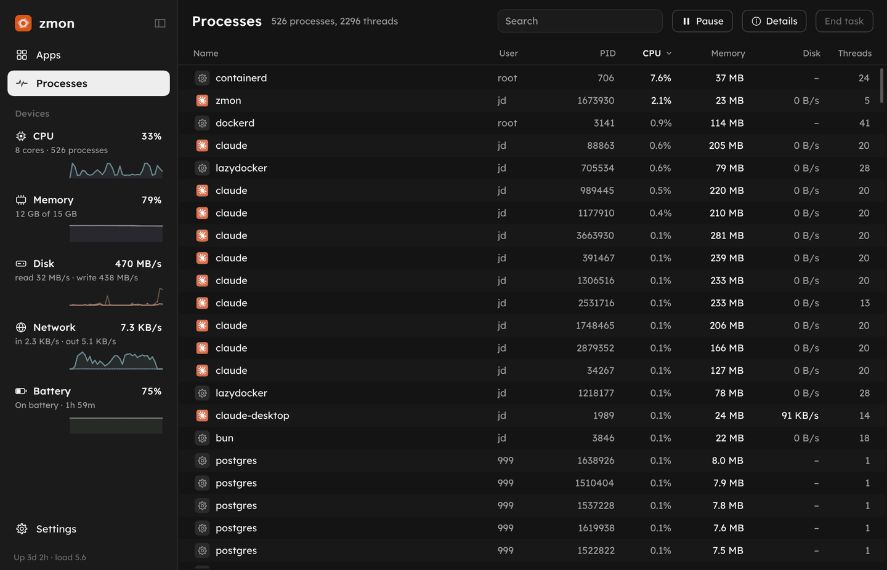
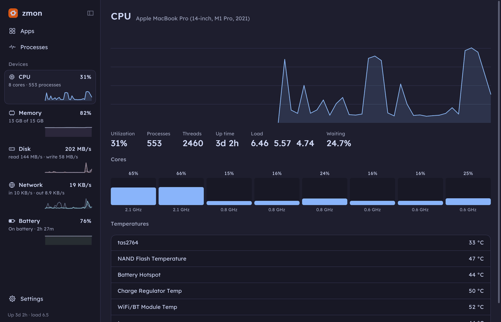

<div align="center">


<h1>zmon</h1>

<p><strong>A system monitor for Linux that groups every process by the app it belongs to.</strong><br>
Live CPU, memory, disk and network, drawn natively in Zig. No webview, no root, no helper process.</p>

<p>


</p>

<p>
<a href="#features">Features</a> ·
<a href="#install">Install</a> ·
<a href="#keyboard">Keyboard</a> ·
<a href="#development">Development</a> ·
<a href="#credits">Credits</a>
</p>


<br><sub>Processes in Graphite Dark: every process with the icon of its app, sorted by CPU, beside live charts for each device</sub>
<br><br>

<br><sub>The CPU page in Catppuccin Mocha: usage over time, load, each core's load and clock speed, and the machine's temperatures</sub>

</div>

## Features

| | |
|---|---|
| **Apps** | The apps you opened, with their launcher icons and the helpers they started folded in. CPU, memory, disk and threads for each, sorted by any column. Open an app to see its processes, or end it with a confirmation. |
| **Processes** | Every process on the machine with its user, PID and the icon of its app. Search by name or PID, or type `:8080` to find what holds a port. End or force quit one process. |
| **Details** | The selected process's command line, state, priority, age and parent, and why it is running: the chain that started it, the systemd unit or container that keeps it, the Git repository it works in, the sockets it holds, and warnings such as running as root. |
| **Devices** | A sidebar tile for the CPU, memory, disk, network and battery, with a chart of the last minute, five minutes or hour. Each opens a page: every core's load, clock and temperature, the memory split and swap, each disk's rates and free space, each interface's rates and address, and the battery's charge, power and time left. |
| **Themes** | 34 built in: Graphite Dark and Light by default, and 32 ported from vicinae, among them Catppuccin, Nord, Gruvbox, Rosé Pine and Tokyo Night. One for dark and one for light, following the desktop or fixed. Add your own in `~/.local/share/zmon/themes/` (see [THEMES.md](THEMES.md)). |
| **Accessible** | Everything works from the keyboard, with a visible focus once you use it. Larger text, more contrast and reduced motion are settings, and every built-in theme is tested for readable contrast. |
| **Light** | Reads `/proc` and `/sys` on its own thread, and only what the page shown needs. No helper process and no root. The one exception asks first: "Show with administrator rights" on a port search, through pkexec, only when you press it. |

## Install

zmon has no releases yet. Build it with Zig 0.17.0; it needs GTK 3 or 4 at run time.

```sh
git clone https://github.com/dagimg-dot/zmon
cd zmon
zig build install -Doptimize=ReleaseFast --prefix ~/.local
```

That puts `zmon` in `~/.local/bin`, and its desktop entry and icon where your launcher finds them. To try it without installing, run `zig build run`.

Settings are saved in `~/.config/zmon/settings.toml`.

## Keyboard

Every page, list and action has a key. Ctrl+? (or F1) shows them all in zmon.

| Keys | Does |
|---|---|
| Ctrl+F | Search apps and processes |
| Ctrl+, | Settings |
| Ctrl+? or F1 | Keyboard shortcuts |
| Ctrl+Shift+P | Pause or resume updates |
| Ctrl+B | Collapse or expand the sidebar |
| Ctrl+Q | Quit |
| Ctrl+1, Ctrl+2 | Apps, Processes |
| Ctrl+3 to Ctrl+6 | CPU, Memory, Disk, Network |
| Ctrl+Page Down, Ctrl+Page Up | Next or previous page |
| Up, Down | Select the row above or below |
| Home, End | First or last row |
| Right, Left | Show an app's processes; hide them, or go back to the app |
| Ctrl+I | Show or hide the selected process's details |
| Delete | End task (Return confirms) |
| Shift+Delete | Force quit: stop it at once, losing unsaved work |
| Esc | Go back where you came from: out of the search (clearing it), the list, the page |
| Any letter | Start a search |
| Tab, Shift+Tab | Move between controls |
| Return | On the sidebar, open that page and move into it |
| Space or Return | Press the focused control |

<details>
<summary><strong>Screen readers</strong></summary>

<br>

Controls and list rows carry names, roles and states for screen readers. nanoui doesn't pass them to Linux's accessibility bus (AT-SPI) yet, so Orca can't read zmon until it does.

</details>

## Development

```sh
zig build check                          # format check, full build, macOS compile check
zig build test                           # data layer, machine readers and the views
zig build bench -Doptimize=ReleaseSafe   # time a sample and a frame, count allocations
```

The views are tested and rendered offscreen, so no window opens while you work: `nui snapshot` draws the app to a PNG. [AGENTS.md](AGENTS.md) has the project's rules, the layout of the code and how to check the look.

History, startup items, a disk analyzer and a floating overlay are planned. zmon is in early development.

## Credits

Inspired by [Systo](https://github.com/MohammedIbrahim8887/systo), and the details pane by [witr](https://github.com/pranshuparmar/witr). Drawn with [nanoui](https://github.com/justrach/nanoui) (MIT), in [Lexend](https://github.com/googlefonts/lexend) (SIL Open Font License, in `src/ui/assets/fonts`). The launcher entry parser comes from gize. The ported themes come from [vicinae](https://github.com/vicinaehq/vicinae) (GPL-3.0), with palettes by their authors; [THEMES.md](THEMES.md) lists them.
